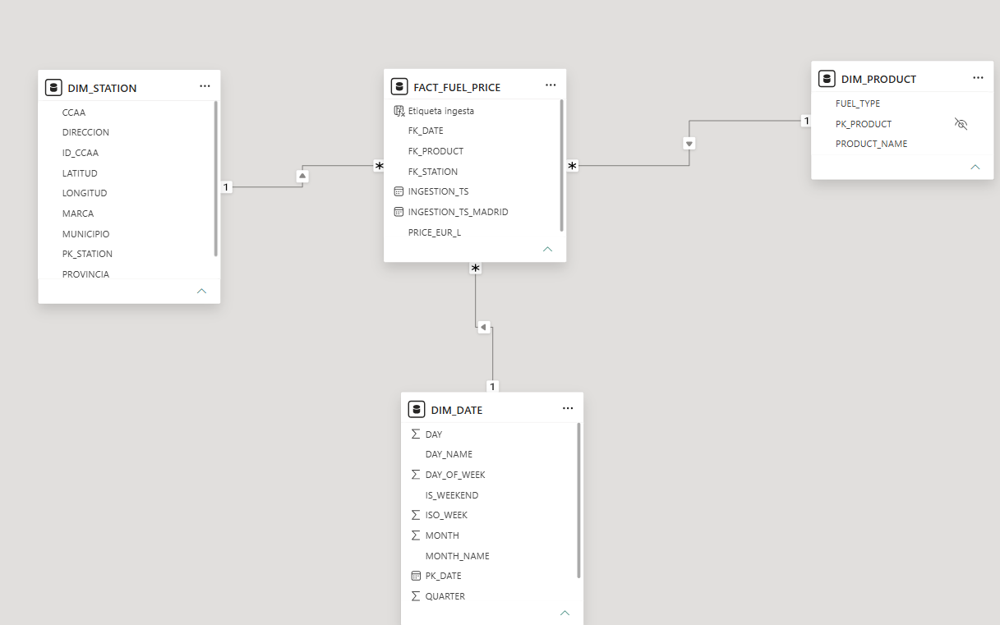
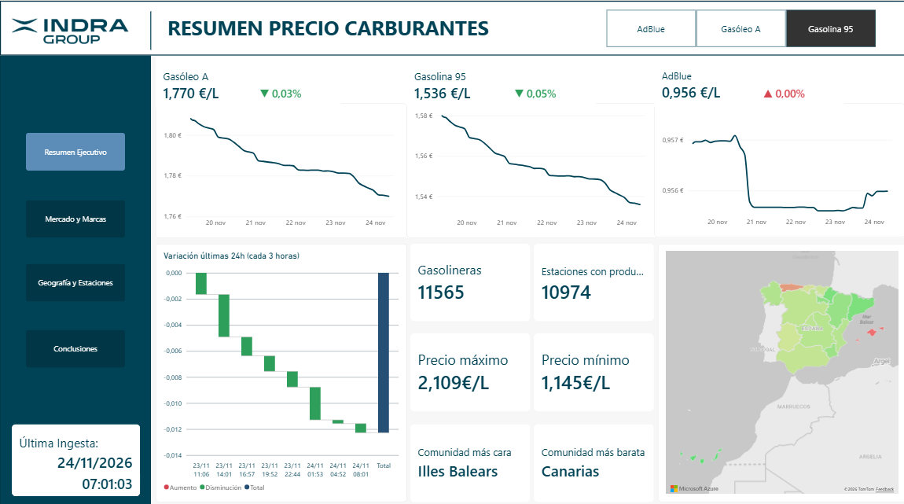
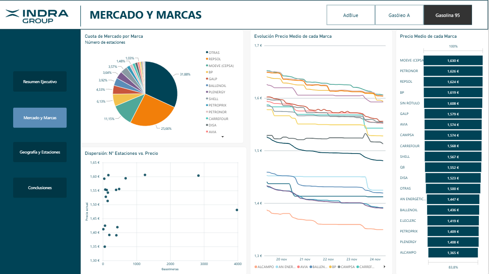
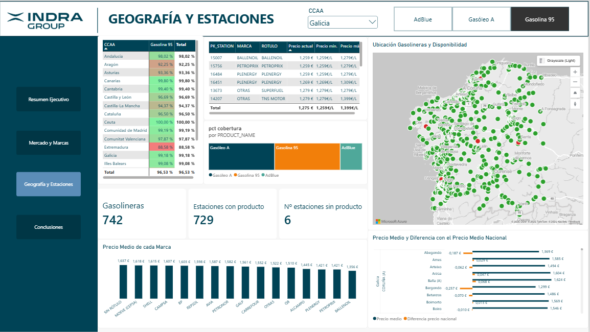
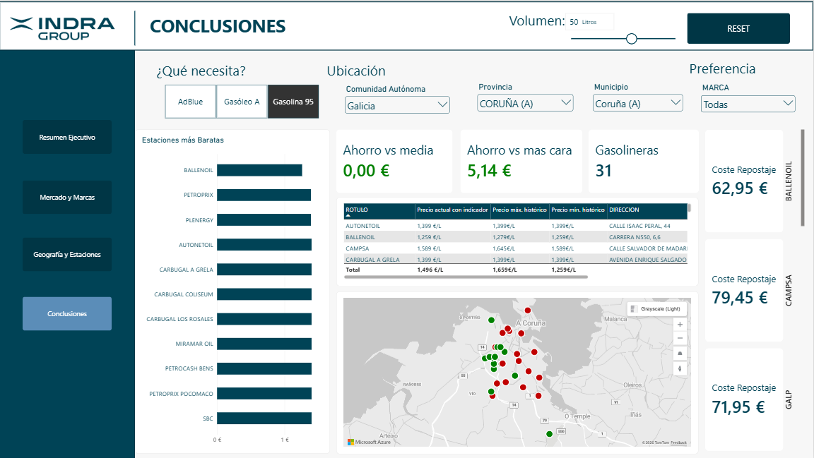

# Análisis de Carburantes en España

## Índice

- [Análisis de Carburantes en España](#análisis-de-carburantes-en-españa)
  - [Índice](#índice)
  - [Introducción](#introducción)
  - [Estructura del proyecto](#estructura-del-proyecto)
  - [Ejecución del proyecto](#ejecución-del-proyecto)
  - [Obtención de datos](#obtención-de-datos)
    - [Fuente de datos](#fuente-de-datos)
    - [Solución de problemas iniciales](#solución-de-problemas-iniciales)
    - [Conexión a la API](#conexión-a-la-api)
    - [Conexión a Snowflake](#conexión-a-snowflake)
    - [Ejecución](#ejecución)
    - [Automatización con Github Actions](#automatización-con-github-actions)
  - [Modelado de datos](#modelado-de-datos)
    - [Capa RAW](#capa-raw)
    - [Capa SILVER](#capa-silver)
      - [Transformaciones](#transformaciones)
        - [Hallazgo 1: Comunidades Autónomas](#hallazgo-1-comunidades-autónomas)
        - [Hallazgo 2: Coordenadas](#hallazgo-2-coordenadas)
    - [Capa GOLD](#capa-gold)
    - [Modelo de Estrella](#modelo-de-estrella)
    - [Automatización del modelado](#automatización-del-modelado)
  - [Dashboard Power BI](#dashboard-power-bi)

## Introducción

Este proyecto desarrolla un flujo de trabajo para estudiar las variaciones en los precios de los carburantes de las gasolineras españolas. El objetivo es focalizarse en una ingesta, limpieza y análisis casi a tiempo real (cada 3 horas).


## Estructura del proyecto

```bash
carburantes/
├── .github/
│   └── workflows/
│       └── github-actions-carburantes.yml  # Fichero yml para automatizar la ingesta
├── img/                      # Imágenes para el readme
├── powerbi/                  # Dashboard negocio
├── src/
│   ├── connections/          # Scripts para conexiones
│   │   ├── api_connect.py    # Conexión a la API del ministerio
│   │   ├── snowflake_load.py # Conexión y carga raw a Snowflake
│   │   ├── ingest.py         # Función para ejecutar todas las conexiones
│   ├── utils/                # Funciones auxiliares
│   └── main.py               # Fichero para automatizar
├── sql/
│   ├── setup/                # Queries de preparación
│   ├── silver/               # Preparación de datos capa silver
│   ├── gold/                 # Tablas de hechos y dimensiones capa gold
│   └── tasks/                # Actualización de silver y gold con nuevas ingestas
├── .env_example.txt          # Fichero de ejemplo para credenciales
└── requirements.txt          # Fichero de dependencias
```

## Ejecución del proyecto

Para ejecutar las conexiones mediante `main.py` es necesario tener instaladas las dependencias. Para eso, ejecutar este comando en su entorno virtual:

```bash
pip install -r requirements.txt
```

> [!WARNING]
> En este proyecto no es necesario realizar una ejecución manual para ver los resultados, gracias a que se ha automatizado toda la pipeline.

## Obtención de datos

### Fuente de datos

Los datos se obtienen a traves de la conexión a la [API REST](https://sedeaplicaciones.minetur.gob.es/ServiciosRESTCarburantes/PreciosCarburantes/EstacionesTerrestres/) que proporciona el Ministerio de Transportes, sobre los precios que ofrecen todas las gasolineras españolas.

### [Solución de problemas iniciales](src/connections/api_connect.py)

Al tratar de conectarme a la API obtenía un error de conexión SSL. Para solucionarlo, hubo que modificar la configuración de la conexión para que fuese menos restrictiva.

### [Conexión a la API](src/connections/api_connect.py)

En el fichero `api_connect.py` se conecta a la API mediante el módulo de python `request` que lanza una petición para descargar los datos en formato `.json`.

### [Conexión a Snowflake](src/connections/snowflake_load.py)

Para conectarse a Snowflake es necesario crear un fichero `.env` con la estructura de `.env_example.txt` rellenándolo con las credenciales personales de Snowflake.

Con esto listo, generamos una conexión con Snowflake mediante la función `connect()`. Con la función `create_table()` crearemos una tabla donde se almacenarán los datos en bruto (RAW). Finalmente con las funciones: `insert_data()` y `register()` inseramos en la tabla que se creó anteriormente los datos que obtuvimos a través de la API.

### Ejecución

Para simplificar el flujo de trabajo, he creado la función [`ingest()`](src/connections/ingest.py) que ejecuta todos los pasos anteriores.
Esta función es llamada en el `main.py` para iniciar el flujo de la pipeline. Esto ayuda en la posterior automatización para ejecutar el script.

### Automatización con Github Actions

Para conseguir que la ingesta sea periódica cada 3 horas y no tener que estar pendientes de la ejecución del script, he creado un flujo en Github Actions.

Es importante que para que el flujo completo funcione correctamente, crear en Github unos secrets con las variables del fichero `.env`.

El flujo se puede consultar el el fichero .yml siguente: [`github-actions-carburantes.yml`](.github/workflows/github-actions-carburantes.yml). En el se definien los siguientes pasos que la VM de Github tiene que seguir para ejecutar la pipeline:

1) Clonar el repo
2) Instalar Python: 3.14.10
3) Instalar las dependencias a través del `requirements.txt`
4) Ejecutar la ingesta usando: los secrets previamente creados en Github y el `main.py`

## Modelado de datos

El proyecto sigue una arquitectura Medallion y modelo de estrella que iré desgranando capa por capa:

### Capa RAW

En la capa RAW se han creado dos tablas: 

- Una tabla para almacenar los datos en bruto
- Otra tabla para registrar cada ingesta

En `FUEL_PRICES_JSON` se alamacenan dos cosas: la hora de ingesta de los datos, y los datos estructurados en un fichero `.json` tal cual como vienen de origen.

Por otro lado, `INGESTION_LOG` almacena unos logs por cada ingesta: la hora de ingesta, el numero de estaciones que se detectan, las filas que se insertan en `FUEL_PRICES_JSON` y su estatus.

Esta tabla permite no solo llevar un registro de las ingestas, sino que también proporciona unas verificaciones sencillas para detectar posibles anomalías en la ingesta de datos.

### [Capa SILVER](sql/silver/)

En la capa SILVER ya se empiezan a modelar los datos, se crean algunas dimensiones: `DIM_PRODUCT` y `DIM_STATION` que recogen las características de los productos y gasolineras. Y la tabla de hechos `FCT_PRICE_SNAPSHOT` 

<a id="granularidad"></a>

> **Granularidad:** fila por estación y por producto que ofrece, es decir:

| IDEESS | Combustible | Precio |
| ------ | ----------- | ------ |
| 2403   | Gasolina 95 | 1.599  |
| 2403   | Gasóleo A   | 1.869  |

Además, he añadido una tabla auxiliar para identificar las comunidades autónomas a través de su ID. Ya que en los datos que proporciona la API solamente identifica las comunidades por su ID. Así que para poder utilizar esos campos en el dashboard.

#### Transformaciones

En este caso, no hizo mucha falta hacer demasiadas transformaciones para normalizar y limpiar datos gracias a que la API proporciona los datos bien estructurados en un `.json`. 

La estructura de este fichero principalmente se puede reducir a una lista de datos por estación de servicio y la fecha y hora en la que se han recogido esos datos. Por tanto, para modelar y construir tablas simplemente habrá que poner el foco en esa lista dentro del fichero `.json`.

##### Hallazgo 1: Comunidades Autónomas

Como ya se mencionó anteriormente, los datos originales se refieren a las comunidades autónomas mediante un id. Este identificador, no es útil para construir un dashboard ya que no aporta información si no se conoce a que corresponde.

Para optimizar este pequeño déficit, se ha construido una tabla auxiliar con las referencias de cada id con su comunidad.

##### Hallazgo 2: Coordenadas

En algunos casos (concretamente 4) hay coordenadas cuya longitud y latitud valen 0, esto es claramente un error principalmente porque esas coordenadas no están dentro del país. Este error se ha gestionado identificando esos valores y asignándoles el valor de NULL, para que no puedan influir en otras métricas.

Por otro lado, hay una estación que tiene la longitud y latitud intercambiadas. Se ha supuesto que están intercambiadas porque colocadas correctamente son las coordenads de Tui, Pontevedra. 

| IDEESS | ROTULO | MUNICIPIO | LAT | LON |
|---:|---|---|---:|---:|
| 16268 | GUAY | Tui | -8.659472 | 42.037472 |

Para corregirlo, simplemente se ha añadido una gestión de rangos para estructurar correctamente estas coordenadas.

### [Capa GOLD](sql/gold/)

En la capa GOLD solamente se incluyen las tablas que necesitaré para crear el dashboard. Las tablas son las siguientes:

- Dimensión fechas
- Dimensión productos
- Dimensión estaciones
- Hechos precio del fuel

### Modelo de Estrella

El modelo de estrella de este proyecto está compuesto por tres dimensiones: estación, producto y fecha, y una tabla de hechos donde cada registro es una estación por producto, como se definía en la [granularidad](#granularidad)



### [Automatización del modelado](sql/tasks/)

Para que las tablas de las capas SILVER y GOLD, se vayan actualizando a medida que se ingesten nuevos registros en la capa RAW se crearon un par de Tasks en Snowflake.

Resumidamente, su funcionamiento es el siguiente: con un steam se registran los nuevos registros en RAW, si los hay la tarea de la capa SILVER crea y actualiza las tablas que se vieron en [SILVER](#capa-silver), y una vez acaba llama a la task de la capa gold que termina de modelar las tablas de la capa SILVER como se vió en [GOLD](#capa-gold).

## Dashboard Power BI

En el dashboard de este proyecto se muestran los datos en 4 hojas: resumen ejecutivo, mercado y marca, geografía y estaciones, y una hoja de conclusiones que ayude al usuario a elegir la gasolinera que más le convenga en función de sus necesidades.







